<p align="center">
  <a href="https://lusor.ai">
    
  </a>
</p>

<p align="center">
  <a href="https://docs.lusor.ai"></a>
  <a href="https://www.npmjs.com/package/@lusor/sdk"></a>
  <a href="LICENSE"></a>
  <a href="https://github.com/lusor-ai/lusor/stargazers"></a>
</p>

<p align="center">
  <a href="https://x.com/lusor_ai"></a>
  <a href="https://discord.gg/9tET4gQPV4"></a>
</p>

**The API for AI agents to use real phone apps.** Lusor agents use real apps on a real phone: your own iPhone or Android, or a Lusor Phone in the cloud. Give an agent a task in plain language. It opens the apps, taps, types and swipes, asks you when it needs you, and reports back with a recording of every step.

<!-- Demo slot: a recorded task on a real phone goes here (GIF or video, under 10 MB). -->

## Why Lusor

- **116/116 on AndroidWorld.** Google Research's benchmark of 116 tasks across 20 Android apps, graded on Mobilerun's fork of its grader. That's the Lusor Harness at the build in production on 9 November 2026; the open-source release in this repository has not been benchmarked. [Results](https://lusor.ai/benchmarks/androidworld)
- **48.2 s median per task, $2.95 for all 116.** Measured model cost for the whole run, helper checks included.
- **Your phone or a cloud phone.** Your own iPhone or Android, or a Lusor Phone in the cloud.
- **Seven AI apps, one setup.** Use Lusor from Claude, ChatGPT, Cursor, Codex, Grok, Hermes or Pi. [Power your agent](#power-your-agent)
- **The phone part, handled.** Connecting the phone, reading the screen and acting on it, with agent runs recorded by default. You send a task and get the result.

⭐ Star this repo to follow the open-source harness release.

---

## Feature overview

| Feature | What it does |
| --- | --- |
| [**Agents**](https://docs.lusor.ai/agents/create-an-agent) | A persistent agent with its own phones, model and instructions. |
| [**Tasks and sessions**](https://docs.lusor.ai/agents/send-a-turn) | Send a task in plain language, follow the run live, and read the result. |
| [**Questions**](https://docs.lusor.ai/agents/answer-the-agent) | At a sign-in or a decision, the agent pauses, asks you, and waits for your answer. |
| [**Structured output**](https://docs.lusor.ai/agents/structured-output) | Get the result back as JSON in a shape you define. |
| [**Recordings**](https://docs.lusor.ai/agents/follow-a-session) | Watch a task back as video, or step through it action by action. |
| [**Direct control**](https://docs.lusor.ai/phones/direct-control) | Read the screen, tap, type, swipe and launch apps yourself, up to 20 actions per request. |
| [**Live view**](https://docs.lusor.ai/phones/live-view) | Stream a phone's screen into your own app over WebRTC. |
| [**Lusor Phones**](https://docs.lusor.ai/help/lusor-phones) | Phones in the cloud. Set each one's location, timezone and language. |
| [**Phone numbers and email**](https://docs.lusor.ai/phones/phone-numbers-and-email) | Read the SMS and email that arrive at your workspace's phone numbers and Lusor Inbox addresses. |
| [**App skills**](skills) | Plain-Markdown guides that teach an agent to use a specific app. |

## Which Lusor do I need?

| You want to | Use | Start here |
| --- | --- | --- |
| Hand tasks to an agent on your own **iPhone** | Lusor for Mac (Apple silicon), which connects the iPhone | [Connect your iPhone](https://docs.lusor.ai/help/connect-your-iphone) |
| Hand tasks to an agent on your own **Android** phone | Lusor Launcher on the phone. No cable; you approve its sign-in once from a computer | [Connect your Android phone](https://docs.lusor.ai/help/connect-your-android) |
| Give the agent **its own phone** | A Lusor Phone in the cloud, from [app.lusor.ai](https://app.lusor.ai) | [Lusor Phones](https://docs.lusor.ai/help/lusor-phones) |
| Run agents **from your own code** | The Lusor API and `@lusor/sdk` | [Quickstart](#quickstart) |
| Use your phones from **Claude, ChatGPT, Cursor, Codex** and other AI apps | The Lusor MCP server | [Power your agent](#power-your-agent) |

## Quickstart

**In the app**

1. Sign in at [app.lusor.ai](https://app.lusor.ai).
2. Open **Phones** → **Add phone** and pick **Personal iPhone**, **Personal Android** or **Lusor Android** (a Lusor Phone).
3. Create an agent, give it the phone, and send it a task.

**From code**

Create a key in the app under **Settings → API Keys**, then install the SDK:

```bash
npm install @lusor/sdk
export LUSOR_API_KEY="lusor_..."
```

```ts
import { randomUUID } from "node:crypto";
import { LusorClient } from "@lusor/sdk";

const lusor = new LusorClient({ apiKey: process.env.LUSOR_API_KEY! });

// 1. Find a connected phone and create an agent on it
const { data: devices } = await lusor.devices.list();
const { data: agent } = await lusor.agents.create({
  name: "My agent",
  devices: [{ device_id: devices[0].id }],
});

// 2. Send it a task
const { data: turn } = await lusor.agents.turns.create({
  id: agent.id,
  prompt: "Open Settings and tell me which software version this phone runs.",
  "Idempotency-Key": randomUUID(),
});

// 3. Wait for the result
const done = new Set(["completed", "complete", "failed", "cancelled"]);
let status = await lusor.sessions.status({ id: turn.sessionId });
while (!done.has(status.status)) {
  await new Promise((r) => setTimeout(r, 3000));
  status = await lusor.sessions.status({ id: turn.sessionId });
}
const session = await lusor.sessions.get({ id: turn.sessionId });
console.log(session.status, session.output);
```

<details>
<summary>The same with curl</summary>

```bash
# 1. Find a connected phone
curl https://api.lusor.ai/v1/devices -H "X-Api-Key: $LUSOR_API_KEY"

# 2. Create an agent on it
curl https://api.lusor.ai/v1/agents \
  -H "X-Api-Key: $LUSOR_API_KEY" -H "Content-Type: application/json" \
  -d '{ "name": "My agent", "devices": [{ "device_id": "<device id>" }] }'

# 3. Send it a task
curl https://api.lusor.ai/v1/agents/<agent id>/turns \
  -H "X-Api-Key: $LUSOR_API_KEY" -H "Content-Type: application/json" \
  -H "Idempotency-Key: first-task" \
  -d '{ "prompt": "Open Settings and tell me which software version this phone runs." }'
```

</details>

The full walkthrough, including how to follow the session and answer the agent's questions, is in the [Quickstart](https://docs.lusor.ai/quickstart). The SDK's own guide is in [`packages/sdk`](packages/sdk), and runnable examples are in [`examples`](examples).

---

## Power your agent

Give your AI app your phones through the Lusor MCP server at `https://mcp.lusor.ai/mcp`. You sign in with your Lusor account; the app never sees a key.

| App | Add Lusor |
| --- | --- |
| [Claude Code](https://docs.lusor.ai/connect/claude) | `claude mcp add --transport http lusor https://mcp.lusor.ai/mcp` |
| [Codex](https://docs.lusor.ai/connect/codex) | `codex mcp add lusor --url https://mcp.lusor.ai/mcp`, then `codex mcp login lusor` |
| [Pi](https://docs.lusor.ai/connect/pi) | `pi mcp add lusor --url https://mcp.lusor.ai/mcp` |
| [Hermes](https://docs.lusor.ai/connect/hermes) | `hermes mcp add --url https://mcp.lusor.ai/mcp --auth oauth lusor` |
| [Cursor](https://docs.lusor.ai/connect/cursor) | [Add Lusor to Cursor](cursor://anysphere.cursor-deeplink/mcp/install?name=lusor&config=eyJ1cmwiOiJodHRwczovL21jcC5sdXNvci5haS9tY3AifQ==) |
| [Claude](https://docs.lusor.ai/connect/claude), [ChatGPT](https://docs.lusor.ai/connect/chatgpt), [Grok](https://docs.lusor.ai/connect/grok) | Add a custom connector with the URL above |

**Building with a coding agent?** Point it at [docs.lusor.ai/llms.txt](https://docs.lusor.ai/llms.txt), the index of every docs page in a form it can read. [Docs for AI agents](https://docs.lusor.ai/connect/for-agents) covers the API spec too.

---

## What's in this repository

| Path | What it is |
| --- | --- |
| [`packages/sdk`](packages/sdk) | `@lusor/sdk`, the TypeScript client for the Lusor API: agents, sessions, phones and direct control, typed from the OpenAPI spec. |
| [`examples`](examples) | Runnable TypeScript examples: run an agent, get structured output, and drive a phone directly. |
| [`skills`](skills) | App skills: plain-Markdown guides that teach an agent to use a specific app, one folder per app. |
| [`skills-unverified`](skills-unverified) | Community and draft skills, before they are verified on a real phone. |
| [`benchmarks/androidworld`](benchmarks/androidworld) | Evidence from Lusor's AndroidWorld run, including the six app skills written for AndroidWorld's test apps, which were in Lusor's skill catalog during the 9 November run. Published as benchmark evidence; Lusor's agent doesn't load them. |

## Open source and Lusor Cloud

| | In this repository (MIT) | Lusor Cloud ([app.lusor.ai](https://app.lusor.ai)) |
| --- | --- | --- |
| API client | `@lusor/sdk` | The Lusor API it calls |
| App skills | The skills catalog | Loaded into every agent run |
| Agent | Coming: an open-source version of the Lusor Harness, the agent that runs these on your own machine | The hosted Lusor Harness, with recordings, questions and structured output |
| Phones | | Your own iPhone or Android through Lusor for Mac or Lusor Launcher, and Lusor Phones in the cloud |
| AI apps | | The Lusor MCP server |

## Benchmark data

Every task from the AndroidWorld run on 9 November 2026 is published, so the result can be checked:

- [Results](https://lusor.ai/benchmarks/androidworld): the score on both graders, with time and cost.
- [All 116 tasks](https://lusor.ai/benchmarks/androidworld/tasks): each task's result, steps and video.
- [Raw data](https://data.lusor.ai/benchmarks/androidworld/2026-11-09/index.json): `task.json`, `steps.json` and the video for every task, with [SHA256SUMS](https://data.lusor.ai/benchmarks/androidworld/2026-11-09/SHA256SUMS).
- [lusor-ai/androidworld](https://github.com/lusor-ai/androidworld): the method, per-task results and step data in one repository.

The score is from the Lusor Harness at the build in production on 9 November 2026, with DeepSeek V4.1 Flash (low effort) choosing its actions. The open-source release is a separate version and has not been benchmarked.

## Resources

- [Documentation](https://docs.lusor.ai)
- [API reference](https://docs.lusor.ai/api-reference/introduction)
- [SDK changelog](packages/sdk/CHANGELOG.md)
- [Help Center](https://docs.lusor.ai/help)

## Contributing

Issues and pull requests are welcome, and new app skills especially. Read [CONTRIBUTING.md](CONTRIBUTING.md) first. To report a vulnerability, see [SECURITY.md](SECURITY.md).

## Responsible use

Use Lusor only with accounts and apps you are allowed to use, and follow each app's terms. App skills cover navigation and app use; skills that get around an app's security, rate limits or terms are not accepted.

## License

MIT. See [LICENSE](LICENSE). Code that carries its own license keeps it; [NOTICE](NOTICE) lists each one.

---

[Website](https://lusor.ai) · [Docs](https://docs.lusor.ai) · [Discord](https://discord.gg/9tET4gQPV4) · [X](https://x.com/lusor_ai) · [Privacy](https://lusor.ai/privacy) · [Terms](https://lusor.ai/terms)
